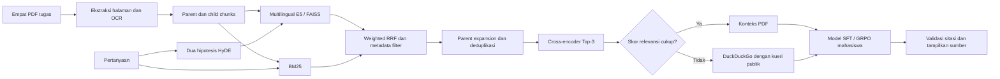

# LexID — Indonesian Legal RAG with Qwen3.8-27B

Pipeline modular untuk riset asisten tim legal Indonesia: **QLoRA/SFT → GRPO → hybrid RAG → jawaban bersitasi**.

**Author:** Kendrick Filbert

> **Source-only portfolio.** Repositori ini dipublikasikan tanpa menjalankan proyek. Output dan execution count notebook dikosongkan. Tidak ada GitHub Actions, training otomatis, deployment, atau layanan yang diaktifkan. Belum tersedia model hasil SFT/GRPO mahasiswa atau klaim akurasi chatbot yang telah diukur.

Versi aktif ini memakai Qwen3.8-27B. Implementasi terdahulu Qwen2.5-1.5B, termasuk notebook, README, requirements, dan tautan modelnya, disimpan di [arsip versi lama](https://github.com/kendrickassignment/legalchatbotdicoding/tree/main/archive/qwen2.5-1.5b). Hasil yang tercantum dalam arsip tersebut berlaku untuk versi lama.

## Apa yang diimplementasikan

| Komponen | Implementasi |
|---|---|
| Model | `Qwen/Qwen3.8-27B`, revision terkunci |
| Data SFT/GRPO | Hanya `Ichsan2895/alpaca-gpt4-indonesian`; normalisasi, deduplikasi prompt, train/validation split, native chat template |
| Fine-tuning | NF4 4-bit, double quantization, FFN LoRA; dua konfigurasi SFT masing-masing 800 steps |
| Reinforcement learning | TRL GRPO; reward format, panjang ringkasan alasan, kemiripan jawaban, dan bahasa Indonesia |
| Ingestion | Empat PDF tugas, metadata halaman, OCR dengan deteksi orientasi dan cache per halaman |
| Retrieval | Multilingual E5 + FAISS, BM25, weighted reciprocal-rank fusion, metadata prefilter, parent-child chunks |
| Advanced RAG | Dua hipotesis HyDE, cross-encoder Top-3, threshold dan fallback DuckDuckGo dengan kueri publik eksplisit |
| Grounding | Sumber bernomor, halaman PDF 1-based, validasi ID sitasi, penahanan jawaban jika sitasi tidak valid |
| Interface | `input()` + `IPython.display.Markdown`, serta Gradio localhost opsional |
| Engineering | CLI, konfigurasi revision, contract tests, validasi bukti submission, packager |

Tabel tersebut menjelaskan kode yang tersedia. Keberhasilan training GPU, peningkatan kualitas GRPO, dan akurasi jawaban legal **belum dibuktikan** oleh repositori ini.

## Arsitektur



## Struktur

```text
src/legal_rag/
  data.py          # preprocessing dataset dan chat template
  training.py      # SFT dan GRPO
  rewards.py       # empat reward functions
  hub.py           # merged export dan verifikasi model publik
  corpus.py        # ekstraksi PDF, metadata, parent-child chunks
  ocr.py           # OCR resumable dan orientasi teks
  retrieval.py     # FAISS/BM25 fusion dan reranker
  faiss_worker.py  # isolasi runtime OpenMP untuk Windows
  generation.py    # hanya memuat model mahasiswa yang terverifikasi
  pipeline.py      # HyDE, sumber, threshold, fallback, sitasi
  interfaces.py    # loop notebook dan Gradio
  evaluation.py    # evaluasi retrieval dan visualisasi log nyata
  cli.py           # entry point
configs/           # konfigurasi model, data, dan hyperparameter
tests/             # source contract tests; tidak dijalankan saat publikasi
scripts/           # pembuat notebook, validator, packager
docs/              # rubrik dan panduan eksekusi manual untuk pengembangan berikutnya
```

Tiga notebook submission disediakan sebagai **source yang belum dieksekusi**. Memanggil `scripts/create_notebooks.py` hanya membuat file notebook, tidak mengeksekusinya.

## Data dan model

Dataset wajib: [Ichsan2895/alpaca-gpt4-indonesian](https://huggingface.co/datasets/Ichsan2895/alpaca-gpt4-indonesian).

Knowledge base tugas: [folder dokumen Google Drive](https://drive.google.com/drive/folders/1LHZ1IncPmmUN5kytFu3i7MoaafFrKDql). Empat dokumen yang diharapkan:

- `PP Nomor 5 Tahun 2021.pdf`
- `PP Nomor 35 Tahun 2021.pdf`
- `PP Nomor 51 Tahun 2023.pdf`
- `UU Nomor 6 Tahun 2023.pdf`

PDF, dataset unduhan, model weights, checkpoint, FAISS index, hasil eksekusi, dan credential tidak dimasukkan ke Git. Folder `data/evaluation/` hanya berisi kueri pengembangan retrieval, bukan data tambahan untuk SFT/GRPO.

Model upstream: [Qwen3.8-27B resmi](https://huggingface.co/Qwen/Qwen3.8-27B). Model ini memakai arsitektur `qwen3_5` dan label Hub `image-text-to-text`, dengan komponen causal language model. Jika rubrik menafsirkan task Text Generation secara ketat, kesesuaiannya perlu diperiksa sebelum submission. Dokumentasi [Unsloth Qwen3.5](https://unsloth.ai/docs/models/qwen3.5/fine-tune) juga mencatat risiko kuantisasi 4-bit; stack GPU di sini merupakan konfigurasi kandidat yang belum diverifikasi dengan training nyata.

## Eksekusi manual di kemudian hari

Tidak ada perintah pada bagian ini yang dijalankan sebagai bagian dari publikasi GitHub. Dokumentasi disediakan untuk pembaca yang kelak memilih menjalankannya sendiri.

```bash
python -m venv .venv
# Aktifkan virtual environment sesuai OS.
pip install -e .
python -m legal_rag.cli preflight
```

Letakkan empat PDF asli di `data/raw/` sebelum ingestion. Langkah GPU tersedia di [runbook](docs/RUNBOOK_GPU.md). Token Hugging Face disimpan di environment variable atau secret manager; `.env.example` hanya mendokumentasikan nama variabel. Tidak ada token yang perlu ditulis dalam notebook.

## Batas yang perlu diperhatikan

- Belum ada artefak fine-tuning, GRPO, model publik mahasiswa, atau jawaban end-to-end yang dapat diklaim sebagai hasil proyek ini. `link_huggingface.txt` menyatakan status tersebut secara eksplisit.
- Threshold reranker masih provisional. Skor cross-encoder dan ID sitasi valid tidak membuktikan seluruh klaim jawaban benar atau didukung sumber.
- Reward bahasa/kemiripan merupakan proxy, bukan pembuktian tata bahasa, reasoning, atau kebenaran hukum.
- OCR tabel memerlukan pemeriksaan relasi baris/kolom pada PDF asli. Dokumen tugas adalah korpus historis, bukan verifikasi hukum terkini.
- Gradio adalah antarmuka localhost opsional. Autentikasi multi-user, deployment, dan operasi production belum tersedia.
- Versi ini belum memenuhi ketentuan submission yang mewajibkan notebook training dijalankan dan model hasil training dipublikasikan. Lihat [matriks rubrik](docs/RUBRIC.md).

## Referensi

- [TRL GRPOTrainer](https://huggingface.co/docs/trl/grpo_trainer)
- [Multilingual E5](https://huggingface.co/intfloat/multilingual-e5-small)
- [Cross-encoder multilingual](https://huggingface.co/cross-encoder/mmarco-mMiniLMv2-L12-H384-v1)
- [Kebutuhan perangkat Unsloth](https://unsloth.ai/docs/get-started/fine-tuning-for-beginners/unsloth-requirements)

Lisensi model, dataset, dan dependensi mengikuti sumber masing-masing. Repository ini tidak memberikan klaim nasihat hukum atau jaminan penilaian submission.
